# conveyor

An open-source software factory: agents groom every issue, build what is worth
building, and review every pull request the community opens.

An open-source project gets more feedback than its maintainers can act on, and the
gap widens as the project grows. Conveyor is a way to keep up with it. It is
opinionated about how its agents work. The main opinion is that a change is proven
by running it, so an agent starts the app and exercises its change through the real
entry point before calling the work done, and does not lean on review alone.

The engine works with any GitHub repository. A deployment is two files of policy on
top of it: `factory.config.json`, which points it at a repo, and `principles.md`,
which says what that project is and what is worth building for it.

<p align="center"></p>

## What it does

- **Grooms the backlog.** Each issue is judged against `principles.md` before
  anything is built. The verdict is a label plus a signed comment on the issue. Edit
  the issue or reply to it and it is judged again.
- **Builds groomed issues.** A fresh coding agent (a Cursor cloud agent or a local
  Claude Code session) takes the issue, builds it without unit or integration tests,
  tests the change live, and opens a PR that lists what it verified and what it did not. When CI
  fails, the failing checks go back to the same agent to fix.
- **Finishes outside PRs.** A contributor's PR is reviewed against the same
  principles, verified the same way, fixed on its own branch (any unit or integration
  tests it carries are deleted there), and then merged or closed with a reason.
- **Keeps the repo healthy.** Further agents batch Dependabot updates, fix security
  alerts, and repair the sandbox when an agent could not run a check it needed. An
  optional agent opens PRs that only remove code.
- **Leaves the throttle with people.** A person merges what the factory builds, and
  one number (`maxConcurrentJobs`) sets how much work can be in flight at once.

State lives on GitHub in labels and comments. The factory keeps no database.

## Running it

```bash
npm install
cp factory.config.example.json factory.config.json   # point it at your target repo
cp principles.example.md principles.md               # then rewrite it for your project
cp .env.example .env    # CURSOR_API_KEY, or nothing for the claude-code worker
gh auth status          # needs repo scope on the target repo
npm run factory -- run --dry-run   # show what a tick would do, launch nothing
npm run factory -- run             # one tick
```

[Deploying](docs/how-it-works.md#deploying) covers keeping your policy in a fork
and pulling engine updates, and [Daily trigger](docs/how-it-works.md#daily-trigger)
covers running it on a schedule.

## Learn more

[docs/how-it-works.md](docs/how-it-works.md) covers every phase, label, and setting,
along with the reasons behind each one.

## License

[MIT](LICENSE)
